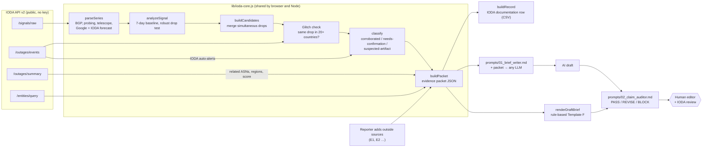

# IODA Report Studio

**Georgia Tech VIP · IODA · Subteam 2 (AI-Assisted Documentation & Public Reporting)**
Version 0.2.0 · 12 November 2026 (0.2.0 adds audience prompts)

IODA Report Studio turns IODA's raw Internet-measurement data into **evidence-tagged outage briefs for journalists**. It has four parts:

- a dashboard (`index.html`);
- a shared analysis library (`lib/ioda-core.js`);
- two LLM prompts (`prompts/`);
- a command-line pipeline with a validation suite (`cli/`).

Every number in a brief is computed from IODA API v2 data. Every sentence carries an evidence tag. An LLM is used only to write prose from a fixed evidence packet, and its draft is audited claim by claim before a human sees it.

- **Live demo (saved cases, Claude drafting):** https://claude.ai/artifact/Sz2gLaJrBrqQb1P3zF4oBA. Private until shared from its Share menu.
- **Run locally (live IODA API):** `python3 -m http.server 8000`, then open http://localhost:8000.
- **Presentation:** [docs/IODA-Report-Studio-presentation.pptx](docs/IODA-Report-Studio-presentation.pptx): 17 slides with speaker notes, following the rubric order.

---

## 1. Research goal

### Problem statement

When the Internet goes down in a country, journalists turn to IODA's dashboard, but the charts are easy to misread:

- A normalized line at "5%" gets reported as "5% of people online."
- One noisy signal gets reported as an outage.
- A drop that is really an IODA measurement fault (we found one that hit 189 countries in the same minute) can look like a national blackout.

Our Week 5 work produced two AI-assisted Template F briefs (Afghanistan 2025, Iran 2026) from published IODA articles. Its claim audit left three items **open**:

1. **Raw hourly measurements:** API data had not been downloaded or validated.
2. **User impact & cause:** the briefs had to avoid unsupported claims.
3. **Human approval:** no review gate existed in the tooling.

The Afghanistan source also contradicted itself: "12:30 a.m." in the introduction, "12:30 PM UTC" in the timeline.

### Intended outcome

A repeatable, auditable pipeline from **IODA raw data → evidence packet → draft brief → claim audit → human gate**, which:

- computes every figure from IODA's API rather than reading chart images;
- applies IODA's own outage rule (2+ simultaneous signal drops, or 1 signal + outside confirmation) consistently;
- catches IODA-side measurement glitches before they reach a reporter;
- lets an LLM help with wording without letting it add facts;
- produces IODA's outage-documentation row in the same pass.

---

## 2. Methods

### System overview



| Component | File | What it does |
| --- | --- | --- |
| Core library | `lib/ioda-core.js` | API client, signal analysis, outage detection, glitch check, evidence packet, Template F renderer, IODA documentation row, prompt bundling. No dependencies; runs in the browser and in Node 18+. |
| Dashboard | `index.html` | Query any country, region or ASN; chart signals as % of normal; pick a drop; get the brief, LLM prompt, Claude draft, audit, CSV row and packet. Opens on saved cases when the live API is unreachable. |
| Writer prompt | `prompts/01_brief_writer.md` | System prompt: packet → Template F brief with five evidence tags, 12 rules, good/bad examples, silent self-check. |
| Auditor prompt | `prompts/02_claim_auditor.md` | Fact-checks a draft against the packet claim by claim, including each audience's format and length; returns PASS / REVISE / BLOCK. |
| Audience profiles | `prompts/03_audiences.md` | Six audiences (newsroom, breaking-news alert, fact-check desk, policy and human rights, general public and social, network operators). Each has its own format, length limit and evidence style. The dashboard's **Audience prompts** tab and `cli/report.mjs --audience` build ready-to-paste prompts from them. |
| Report CLI | `cli/report.mjs` | One command → `result.json`, `packet.json`, `draft.md`, `prompt-bundle.md`, `record.csv`. |
| Validation | `cli/validate.mjs`, `data/reference_cases.json` | Re-runs the pipeline on reference outages and checks it against what IODA published. Writes `data/validation/validation-report.md` and the saved cases in `data/cases/`. |

### Detection method

For each of four signals (BGP, active probing, Merit network telescope, Google Search traffic):

1. **Baseline.** "Normal" is the signal's median over the 7 days before the window. For Google traffic we use IODA's own SARIMA forecast and threshold (`gtr-sarima`), which already models daily cycles.
2. **Drop test.** A reading is a drop when it is both **k × MAD** below the median (a robust z-score) **and** at least a minimum share under it:

   | Signal | k | Minimum fall |
   | --- | --- | --- |
   | BGP | 4 | 3% |
   | Active probing | 4 | 10% |
   | Telescope | 3 | 40% |
   | Google traffic | below IODA's forecast threshold | 30% under forecast |

3. **Segments.** Consecutive drops form a segment; up to 2 undropped points are tolerated inside one segment, and segments under 20 minutes are discarded.
4. **Candidates.** Segments from different signals within 30 minutes of each other merge into one candidate outage.
5. **Classification.**
   - **corroborated**: 2+ signals dropped together and at least one is BGP or probing.
   - **needs-confirmation**: everything else.
   - **suspected-artifact**: the same signal dropped in **20+ other countries within ±20 minutes**. This is checked with a country-wide `/outages/events` query.
6. **Glitch-aware minimum.** If a candidate's lowest reading lands on a platform-wide glitch, that reading is excluded for the glitch's real duration. The brief quotes the lowest reading outside it.
7. **IODA's own view.** IODA's automatic alerts (`/outages/events`), severity score, and the ASNs and regions that alerted in the same window (`/outages/summary?relatedTo=`) are attached as `[IODA-ALERT]` evidence.

### Evidence tags

These extend the Week 5 scheme (documented / independently corroborated / interpreted / missing):

| Tag | Meaning |
| --- | --- |
| `[IODA-DATA S1]` | Measured from IODA raw signals by this pipeline |
| `[IODA-ALERT S2]` | IODA's own detector, event log, severity score, or the glitch check |
| `[CORROBORATED E1]` | Outside source a human added (operator statement, Cloudflare Radar, local reporting) |
| `[INTERPRETED]` | Hedged inference, taken only from the packet's `interpretationsToCheck` |
| `[MISSING]` | Something readers need that the data cannot establish (cause, people affected, user recovery) |

### Prompt engineering

The writer prompt (`01_brief_writer.md`) uses five techniques:

- a defined role and reader (deadline reporters, four questions in a fixed order);
- a typed input schema;
- **rules that state their reasons**, so the model can generalize to cases they don't cover;
- a fixed output skeleton with the six Template F headings;
- a bad/good sentence table built from real failure modes, plus a silent self-check.

The auditor (`02_claim_auditor.md`) is adversarial by design:

- it assumes the draft is wrong;
- it maps every claim to a packet field path;
- it returns BLOCK on any WRONG or OVERSTATED claim.

It should run in a fresh context, or on a different model from the writer.

**Audience prompts (v0.2.0).** Different readers need different outputs from the same evidence. `prompts/03_audiences.md` holds six profiles:

| Audience | Output | Limit | Evidence style |
| --- | --- | --- | --- |
| Newsroom reporter | Template F brief | 300–500 words | tags in the text |
| Breaking-news alert | Headline and three sentences | ≤ 90 words | clean text + evidence table |
| Editor / fact-check desk | Verdict, safe to say, not supported, verify next | ≤ 300 words | tags in the text |
| Policy & human rights | Neutral key-facts table and suggested citation | ≤ 300 words | clean text + evidence table |
| General public & social | Plain-language explainer and one social post | ≤ 120 words + 280 characters | clean text + evidence table |
| Network operators & researchers | Per-signal measurements and open technical questions | ≤ 350 words | tags in the text |

Every profile inherits all writer rules. Publishable formats keep the text clean and put the evidence tags in an **evidence trail** table after it, so the auditor can still check every claim. A shared rule ties wording to the classification for every audience: a likely glitch never becomes an alert, post or policy summary. Profiles are plain markdown between marker comments, so the team can edit them or add new ones without touching code.

The dashboard always shows a **rule-based draft** next to the AI draft. That gives a no-LLM control for comparison, and a fallback if no model is available.

### Testing methodology

`node cli/validate.mjs` pulls live IODA data for five reference cases and checks the detector against published claims (18 checks):

| Case | Why it's in the set |
| --- | --- |
| Afghanistan, 29 Sep 2025 | Nationwide shutdown; published timestamp conflict |
| Iran, 8–30 Jan 2026 | Long shutdown with staged recovery |
| Haiti, 27 Oct 2026 | Partial drop in three signals |
| Ireland, 18 Oct 2026 | **Negative control**: platform-wide glitch |
| Guam, 17–20 Oct 2026 | Probing-only outage with a glitch inside it |

The "published" side comes from IODA's reports as cited in our Week 5 deck ([A1], [I1]) and from our 12 Nov 2026 analysis of IODA's event API.

### How AI was used

| Where | Model | Role |
| --- | --- | --- |
| Building this repo (API analysis, code, prompts, docs) | Claude (Claude Code, Opus 5.5) | Pair-programmer; every output was run against the live API, and the validation suite is the check |
| Brief drafting (optional) | Any chat LLM; Claude in the hosted demo via the artifact `sample` capability | Writes prose from the packet only |
| Claim audit (optional) | Any chat LLM, ideally a different model or fresh context | Fact-checks the draft against the packet |

Detection, classification, numbers and the documentation row are **deterministic code**, not LLM output.

### Challenges and how we addressed them

| Challenge | Resolution |
| --- | --- |
| Published pages (claude.ai artifacts) cannot call outside APIs | The dashboard detects this and opens on **saved case files** (real API pulls) instead; run locally or on any static host for live data. The IODA API allows cross-origin requests. |
| **False positive** in the first validation run (v0.1.0, 16/17): a 1-hour telescope + Google dip in Ireland was called an outage | Tightened IODA's 2-signal rule: at least one of the two must be BGP or probing (v0.1.1). See `data/validation/validation-report-v0.1.0.md`. We also restated the control check as "glitch flagged and nothing presented as a corroborated outage", because v0.1.0's wording also failed correctly labelled "needs confirmation" drops. |
| A real outage's **lowest point fell on a glitch minute** (Guam: 19.6% at 00:00 UTC Oct 18, when 189 countries "dropped") | Check each candidate's minimum against country-wide events; exclude the glitch span; quote 40.5% (01:40 UTC) instead. |
| `/outages/events` **clips event durations to the query window** (every glitch event came back as exactly 20 min) | Query 6 h past the time of interest when measuring durations. |
| `/outages/events?overall=true` with an `entityCode` returns HTTP 500 | Not used; we merge signals ourselves. |
| `gtr-sarima` values are objects (`{observed, predicted, threshold}`), not numbers | Parsed separately and attached to Google traffic as forecast and threshold. |
| Afghanistan source said both "12:30 a.m." and "12:30 PM UTC" | Resolved from raw data (below); the writer prompt now forbids a.m./p.m. |

---

## 3. Results and findings

### Validation: 18 of 18 checks pass (v0.1.1)

Full detail: `data/validation/validation-report.md`.

| Case | Published by IODA | Detector, from raw API data | Checks |
| --- | --- | --- | --- |
| **Afghanistan**, 29 Sep 2025 | First drop ~11:00 UTC; sustained ~12:30 UTC; probing <5%; restored ~11:45 UTC Oct 1 | Probing falls from **11:30**, Google **12:00**, BGP **12:10 UTC**; probing low **3.8%**; probing back **12:50 UTC Oct 1** (+1.1 h) | 5/5 |
| **Iran**, 8 Jan 2026 | Shutdown 16:30 UTC; probing ~3%; telescope near zero by 18:45; telescope back Jan 24, probing Jan 27 | Probing falls at **16:30 UTC**; telescope **0% at 18:45**; probing low **3.3%**; telescope back **Jan 24 16:15**, probing **Jan 28 09:30** | 5/5 |
| **Haiti**, 27 Oct 2026 | Google drop 17:30 UTC; BGP 17:50 UTC | Probing **17:20**, BGP **17:50**, Google **18:00 UTC**; partial (BGP 87%, probing 80%, Google 47%) | 3/3 |
| **Ireland** control, 18 Oct 2026 | 189 countries "dropped" at 00:00 UTC | Flagged **suspected-artifact (188 other countries)**; nothing else called an outage | 1/1 |
| **Guam**, 17–20 Oct 2026 | Probing-only disruption | Probing only (BGP steady); glitch reading excluded; low **40.5%** | 4/4 |

### Findings for IODA and for reporters

1. **The Afghanistan timestamp conflict is resolved: 12:30 PM UTC.** All three infrastructure and traffic signals began falling between 11:30 and 12:10 UTC on 29 Sep 2025. Nothing in the raw series supports "12:30 a.m."
2. **Routing understates shutdowns.** In Iran, BGP only fell to 86% while probing fell to 3.3% and the telescope to 0%. A brief built on BGP alone would have badly misreported Iran. This matches IODA's own note in [I1].
3. **Recovery depends on the signal.** In Iran, signals came back above threshold on four different dates: BGP Jan 18, Google Jan 22, telescope Jan 24, probing Jan 28. This is why the prompts forbid a single "service restored" claim.
4. **IODA-wide glitches are common enough to matter.**
   - Probing glitches: 189 countries at 00:00 UTC Oct 18, and 52 at 22:20 UTC Oct 15.
   - BGP glitches: about 60 countries twice on Nov 9.
   - Probing everywhere dipped at 14:00 UTC Oct 31.

   Any automated or AI pipeline over IODA data needs a glitch check.
5. **Telescope + Google alone is not enough** to call an outage (the Ireland false positive).

### Demo

1. Open the dashboard: hosted link above, or locally.
2. Pick **Afghanistan**. The chart shows all signals collapsing on 29 Sep. The drops table shows C1 "Outage, 2+ signals" with IODA's own alerts.
3. **Brief draft** tab: the rule-based Template F brief, every line tagged.
4. **Audience prompts** tab (or the **Write a brief for an audience →** button): pick one or more audiences and a language, then **Copy prompt** and paste it into any model. In the hosted demo, **AI draft → Write with Claude** streams the draft for the chosen audiences.
5. **Audit** tab: run the auditor on the AI draft and get PASS / REVISE / BLOCK with a claim table.
6. **Outside sources**: add "Operator confirms…" with a link. It appears as `[CORROBORATED E1]` in the brief, packet and prompt.
7. Pick **Ireland (control)** to show the glitch being caught, and **Guam** to show the × marker where the glitch reading was excluded.
8. **Documentation row** tab: the row for IODA's outage-documentation sheet, as CSV.

---

## 4. Limitations

- **Small reference set.** Thresholds were tuned on 5 cases, so overfitting is likely. Region- and ASN-level detection, mobile-only shutdowns and throttling are untested.
- **Baseline ignores daily cycles** for BGP, probing and telescope; a plain 7-day median is used. Strongly diurnal places can produce false drops at night; Google traffic avoids this via IODA's forecast. If an outage started before the window, the baseline is contaminated.
- **Coarser time steps on long windows.** The API is asked for at most 3,000 points per series. Iran's 29-day pull came back at about 15-minute steps, so onset times are accurate to one step.
- **The infrastructure-signal rule may downgrade real mobile shutdowns.** Mobile networks often don't answer pings, so these can land in "needs confirmation". That is the conservative choice for journalism, but it lowers recall.
- **LLM output is not yet evaluated systematically.** The auditor exists, but we have not run a multi-model comparison or measured audit accuracy against human fact-checkers.
- **No user testing with journalists yet.** The reading order and wording are proposals, as in Week 5.
- **"Published" claims are taken from the Week 5 deck's citations** ([A1], [I1]); the IODA articles were not re-read for this release.
- **"Visible by human" columns are detector proxies.** They are pre-filled and must be confirmed by a person.
- **The IODA severity score covers the whole window**, not each candidate.
- **The hosted demo cannot query the live API.** Live mode needs a local or static-host deployment.

---

## 5. Next steps

1. **Grow the reference set to 30+ documented outages**, including regional, ASN, mobile and throttling cases. Report precision/recall per class, not just pass counts.
2. **Diurnal-aware baseline**: same hour-of-week median over 4 weeks, compared with the current median on the reference set.
3. **Model controls** (Week 5 item): run `01_brief_writer.md` on identical packets across 3+ models and temperatures. Score drafts with the auditor and with a human fact-checker, and measure auditor agreement.
4. **Reader testing**: 3–5 journalists review rule-based vs AI briefs. Record comprehension of "% of normal" vs "% of people".
5. **Automatic outside corroboration**: Cloudflare Radar outage API (needs a token) as `E` sources, still labelled as automated.
6. **Deploy live mode on GitHub Pages.** The site is static and the IODA API allows cross-origin calls, so it should run as-is.
7. **IODA team review** of the classification rules, glitch threshold and prompt wording before any public use.
8. **Newsroom watch mode**: scheduled CLI runs that post new corroborated candidates for a watch-list of countries.

### Problem statement for the next phase (Spring 2027)

> Journalists need fast, correct explanations of Internet disruptions, but IODA's signals are easy to misread and AI tools readily overstate them. Report Studio v0.1 showed that a deterministic evidence packet plus an evidence-tagged prompt and an adversarial audit can reproduce IODA's published timelines (18/18 checks on 5 cases) and catch platform-wide glitches. The next phase must find out whether this holds at scale and for real readers:
>
> - Does detection stay accurate across 30+ outages of different types and scopes?
> - Do LLM drafts pass independent fact-checking at a measurable rate?
> - Do journalists using the briefs make fewer interpretation errors than journalists using the dashboard alone?
>
> The deliverables are an evaluated, IODA-reviewed workflow and a public deployment plan.

---

## 6. Documentation for reproducing this work

### Requirements

- Node.js 18+ (uses built-in `fetch` and `crypto.subtle`; tested on Node 26).
- Python 3 only for the local web server (any static server works).
- No API keys. No npm dependencies. The dashboard loads `marked` and `DOMPurify` from cdnjs for Markdown rendering, and falls back to plain text without them.

### Commands

```bash
# 1. Validate the detector against the reference outages (rewrites data/cases + data/validation)
node cli/validate.mjs                 # or: npm run validate
node cli/validate.mjs IR-2026-01-08   # one case

# 2. Build a report bundle for any place and window (times are UTC)
node cli/report.mjs --type country --code HT --from 2026-10-27T00:00Z --until 2026-10-29T12:00Z
node cli/report.mjs --type asn --code 12066 --from 2026-11-09T00:00Z --until 2026-11-12T00:00Z --candidate C1
#    -> out/<type>-<code>-<start>/{result.json, packet.json, draft.md, prompt-bundle.md, record.csv}
node cli/report.mjs --type country --code HT --from 2026-10-27T00:00Z --until 2026-10-29T12:00Z --audience wire,public
node cli/report.mjs --type country --code HT --from 2026-10-27T00:00Z --until 2026-10-29T12:00Z --audience all --language Spanish
#    -> adds prompt-<audience ids>[-<language>].md, ready to paste into any LLM

# 3. Run the dashboard with live data
python3 -m http.server 8000           # or: npm run serve
#    open http://localhost:8000  (opening index.html straight from disk blocks the prompt and case files)
```

To use an LLM without the dashboard, paste `out/.../prompt-bundle.md` into any chat model. For the audit, paste `prompts/02_claim_auditor.md`, the packet and the draft into a fresh chat. `core.buildAuditBundle()` builds the same text.

### Repository map

```
index.html                      dashboard
lib/ioda-core.js                shared pipeline (browser + Node)
prompts/01_brief_writer.md      LLM system prompt: packet -> Template F brief
prompts/02_claim_auditor.md     LLM system prompt: draft + packet (+ audience profiles) -> audit
prompts/03_audiences.md         audience profiles: format, length, evidence style per reader
cli/report.mjs                  one-off report bundles
cli/validate.mjs                validation suite
data/reference_cases.json       reference outages, published claims, checks
data/cases/*.json               saved results (real API pulls) used by the demo
data/validation/validation-report.md         latest run (v0.1.1, 18/18)
data/validation/validation-report-v0.1.0.md  first run (16/17), kept for the record
docs/IODA-Report-Studio-presentation.pptx    17-slide research presentation (rubric order, speaker notes)
```

### Data formats

- **Result file** (`ioda-report-studio-result/1`, `data/cases/*.json`, `out/*/result.json`): query, entity, compact raw series (`v`, plus `e`/`th` forecast for Google), per-signal analysis (`baseline`, `ratios`, `segments`), IODA events, severity score, candidates (signals, alerts, glitch check, related ASNs/regions, classification), and the list of API URLs called. The dashboard opens these with **Open a result file**.
- **Evidence packet** (`ioda-evidence-packet/1`): the LLM input. It has location, window, plain-language signal descriptions with `mustNotBeReadAs`, every candidate in the window, a `focus` block (per-signal start/lowest/recovery, alerts, glitch check, timeline, interpretations to check), sources `S1–S3` plus `E1…`, unknowns, and a SHA-256 fingerprint. The writer prompt's input table documents each field.
- **Documentation row**: columns and order follow the IODA outage-documentation sheet (Begin time … More Info). Times use its `DD/MM/YYYY HH:MM:ss AM/PM` format, in UTC.

### Tuning

All thresholds live in `DEFAULTS` and `SIGNALS` at the top of `lib/ioda-core.js`. After changing one, re-run `node cli/validate.mjs`, and add a reference case for any new failure mode before fixing it.

### Attribution

Data: IODA, Georgia Tech Internet Intelligence Lab (https://ioda.inetintel.cc.gatech.edu). IODA marks its data "All Rights Reserved". Check its terms before republishing charts or bulk data. Briefs produced here are drafts: they need a named human reviewer, and IODA team review before any public release.
